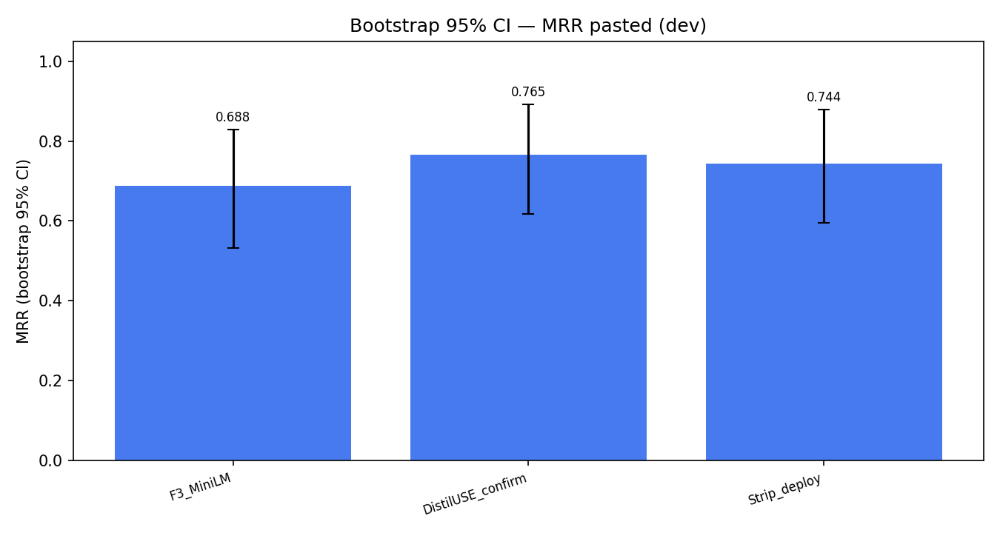
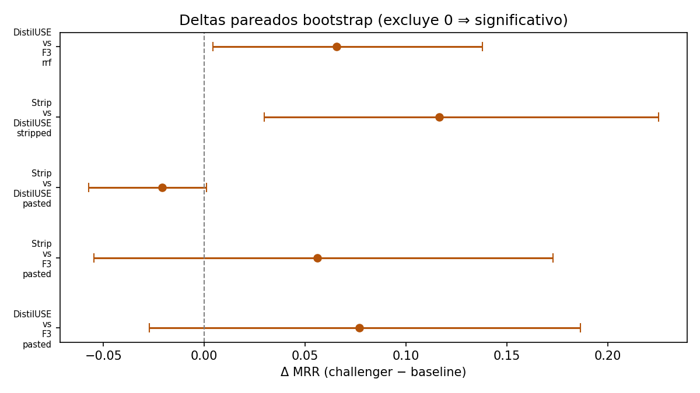
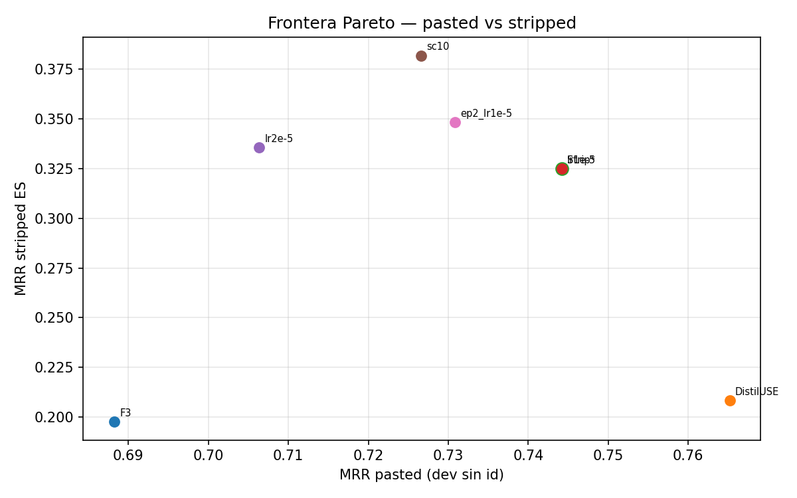
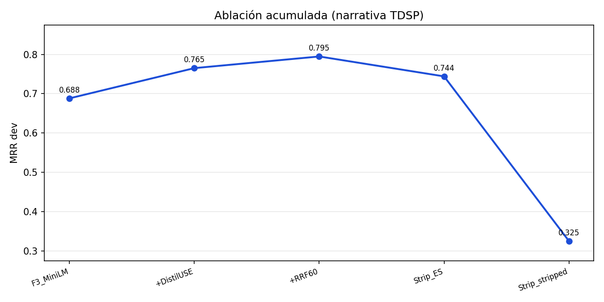
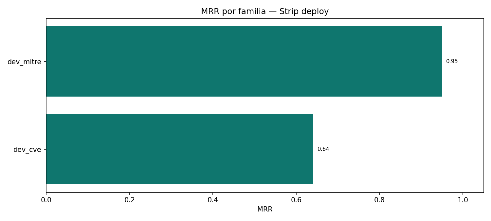
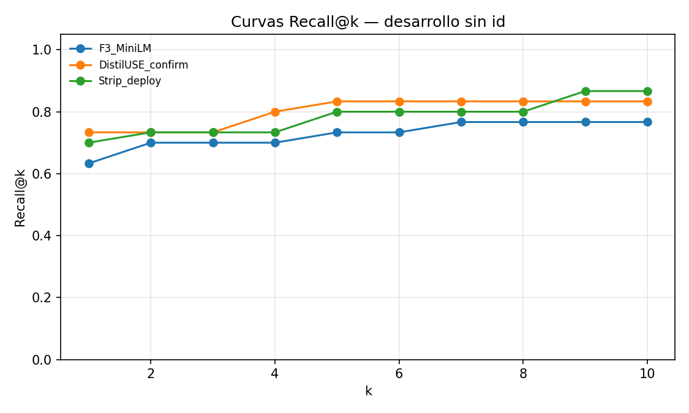
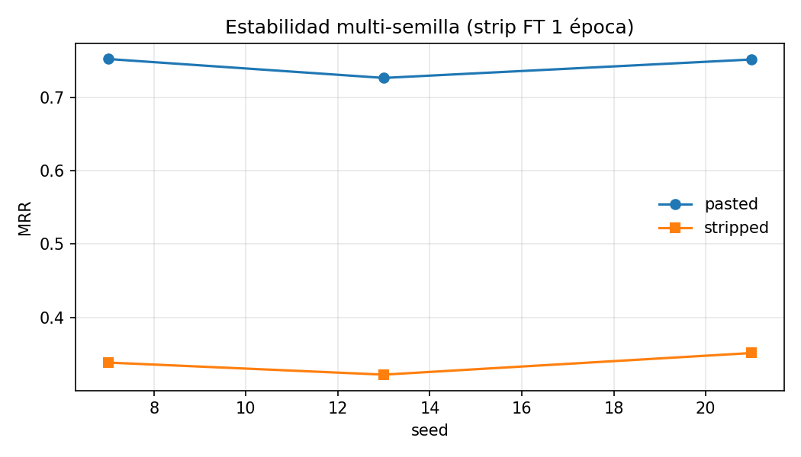
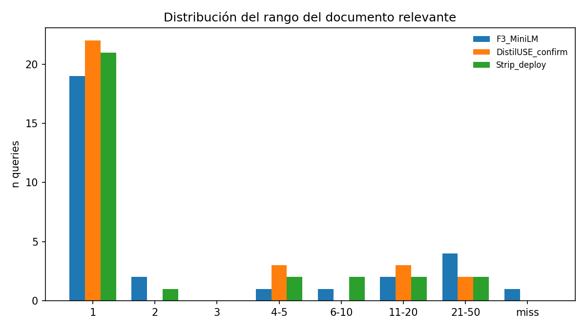

# Evidencia rúbrica Fase IV → banda **[4,0–5,0]**

TTP: campeón de SELECCIÓN pasted = DistilUSE confirm (MRR=0.765, IC95% [0.617, 0.892]). Campeón OPERATIVO ES = Strip lr1e-5 (stripped 0.325 vs DistilUSE 0.208; Δ pareado excluye 0=True). Deploy vigente = Strip (regla multi-objetivo declarada). Seeds strip pasted σ=0.012. Gold no eligió.

## Mapa criterio → artefacto

| Criterio rúbrica | Qué demostrar | Artefacto |
|------------------|---------------|-----------|
| Entrenamiento adecuado | Loss baja, FT real en GPU | `fase4_loss_curves.png`, candidates/ |
| Modelo se ajusta correctamente | ep3/hardneg rechazados; seeds estables | `fase4_ttp_ablation.png`, `fase4_ttp_seeds.png` |
| HP/comparación mejoran | F3→DistilUSE; DistilUSE→Strip(ES) | `fase4_ttp_bootstrap_*.png`, `fase4_ttp_deltas.png` |
| Modelo adecuado al corpus | Retrieval CTI bi-encoder + RRF | `fase4_model_report.md`, demo S1–S5 |

## Números clave (dev sin id; gold reporta)

| Sistema | pasted | stripped | RRF60 | Gold dense |
|---------|-------:|---------:|------:|-----------:|
| F3 MiniLM | 0.688 | 0.198 | 0.729 | 0.890 |
| DistilUSE confirm | 0.765 | 0.208 | 0.795 | 1.000 |
| **Strip deploy** | 0.744 | 0.325 | 0.776 | 1.000 |

Errores R@5 Strip: **6**. Seeds pasted: 7→0.752, 13→0.726, 21→0.752 (σ=0.012).

## Figuras TTP

Veredicto narrativo: [`04_contraste_rubrica.md`](04_contraste_rubrica.md).

**Notebook de cierre:** [`scripts/modeling/Proyecto_Fase4_FineTuning_Validacion.ipynb`](scripts/modeling/Proyecto_Fase4_FineTuning_Validacion.ipynb).

**Fine-tuning en plantilla TDSP:** [`docs/modeling/fine_tuning/`](docs/modeling/fine_tuning/) · [`scripts/training/`](scripts/training/) · mapa [`README.md`](README.md).