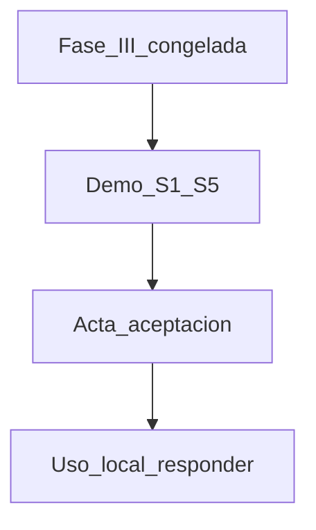

# Acta de aceptación — Fase IV

Fecha UTC: 2026-11-25T04:21:55+00:00

## Criterios

| Criterio | Resultado |
|----------|-----------|
| Media checklist S1–S5 | **5.00** / 5 |
| Pedido ofensivo bloqueado | Sí |
| Checkpoint | `artifacts/fase3/biencoder_best` (2 épocas) |
| Fusión | RRF k=60 · BM25 k1=1,5 b=0,75 |
| Re-ranker en producción | No |
| Umbral | 0,40 |

## Límite operativo

Sin telemetría del SIEM **no** se confirma explotación en la red de quien pregunta. El asistente cita el índice endurecido y se abstiene si falta evidencia.

## Escenarios

- S1: 5/5 — Cita el identificador esperado, con veredicto, acción y límite.
- S2: 5/5 — Cita el identificador esperado, con veredicto, acción y límite.
- S3: 5/5 — Cita el identificador esperado, con veredicto, acción y límite.
- S4: 5/5 — Respuesta de gobierno del proyecto, sin inventar un CVE.
- S5: 5/5 — Abstención explícita, sin asignar CVSS ni KEV al identificador ausente.

