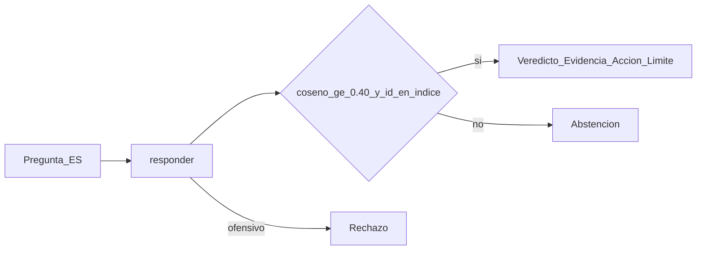

# Demo operativa S1–S5

Generado: 2026-11-25T05:44:23+00:00
Sistema: `biencoder_best` + BM25 + RRF k=60 · umbral coseno **0.4** · sin re-ranker.



## S1 — KEV y prioridad del día

**Pregunta.** ¿La vulnerabilidad CVE-2005-2773 está en CISA KEV y qué prioridad SOC tiene?

**Checklist.** 5 / 5 — Cita el identificador esperado, con veredicto, acción y límite.

```
Veredicto: CVE-2005-2773 SÍ está en CISA KEV; banda P1-immediate (score 84.7).
Evidencia: CVSS 9.8; táctica Execution; CWE CWE-77; producto hp/openview_network_node_manager. Extracto del índice: CVE-2005-2773. KEV=si. banda=P1-immediate. score=84.7. CVSS=9.8. CWE=CWE-77. tactica=Execution. producto=hp/openview_network_node_manager. HP OpenView Network Node Manager 6.2 through 7.50 allows remote attackers to execute arbitrary commands via shell metacharacters in the (1) node parameter to connectedNodes.ovpl, (2) cdpView.ovpl, (3) freeIPaddrs.ovpl, and (4) ecscmg.ovpl.
Acción: Parchear hoy o aplicar de inmediato la mitigación indicada por CISA. Acción CISA registrada: Apply updates per vendor instructions.
Límite: esta respuesta solo usa el índice endurecido. No sustituye la telemetría del SIEM ni afirma que la vulnerabilidad esté explotada en su red.
```

## S2 — Táctica ATT&CK de un CVE

**Pregunta.** ¿Qué táctica ATT&CK es más probable para CVE-2011-2462 y por qué?

**Checklist.** 5 / 5 — Cita el identificador esperado, con veredicto, acción y límite.

```
Veredicto: CVE-2011-2462 SÍ está en CISA KEV; banda P1-immediate (score 84.7).
Evidencia: CVSS 9.8; táctica Execution; CWE CWE-787; producto adobe/acrobat. Extracto del índice: CVE-2011-2462. KEV=si. banda=P1-immediate. score=84.7. CVSS=9.8. CWE=CWE-787. tactica=Execution. producto=adobe/acrobat. Unspecified vulnerability in the U3D component in Adobe Reader and Acrobat 10.1.1 and earlier on Windows and Mac OS X, and Adobe Reader 9.x through 9.4.6 on UNIX, allows remote attackers to execute arbitrary code or cause a denial of service (memory corruption) via unknown vectors, as exploited in…
Acción: Parchear hoy o aplicar de inmediato la mitigación indicada por CISA. Acción CISA registrada: Apply updates per vendor instructions.
Límite: esta respuesta solo usa el índice endurecido. No sustituye la telemetría del SIEM ni afirma que la vulnerabilidad esté explotada en su red.
```

## S3 — Detección de una técnica

**Pregunta.** ¿Cómo detectar la técnica T1047 (Windows Management Instrumentation)?

**Checklist.** 5 / 5 — Cita el identificador esperado, con veredicto, acción y límite.

```
Veredicto: la detección de T1047 (Windows Management Instrumentation) se apoya en la estrategia oficial ATT&CK recuperada.
Evidencia: táctica Execution. T1047 Windows Management Instrumentation. tactica=Execution. Strategy: Behavioral Detection Strategy for WMI Execution Abuse on Windows Analytic 1031: Detects adversarial abuse of WMI to execute local or remote commands via WMIC, PowerShell, or COM API through a multi-event chain: process creation, command execution, and corresponding network connection if remote.
Acción: cazar con las analíticas y fuentes citadas. Esto es orientación defensiva, no un procedimiento de ataque.
Límite: si el chunk no trae una fuente de datos, no la invento.
```

## S4 — Rechazo del dato Kaggle

**Pregunta.** ¿Debo usar estimated_financial_loss_usd de Kaggle para priorizar parches reales?

**Checklist.** 5 / 5 — Respuesta de gobierno del proyecto, sin inventar un CVE.

```
No. La pérdida estimada y el accuracy de severity_level en Kaggle no priorizan parches reales: el datasheet los marca como sintéticos y no discriminan la severidad operativa. La priorización de este asistente usa KEV, CVSS, exploit público y MITRE ATT&CK.
```

## S5 — CVE inventado

**Pregunta.** ¿Qué CVSS, estado KEV y banda SOC tiene CVE-2099-0001?

**Checklist.** 5 / 5 — Abstención explícita, sin asignar CVSS ni KEV al identificador ausente.

```
No hay evidencia suficiente en el índice para responder con seguridad. Declaro incertidumbre: no invento CVSS, estado KEV ni pasos de detección. Indique un identificador válido (CVE-YYYY-NNNN o técnica Txxxx) o más contexto.
```
