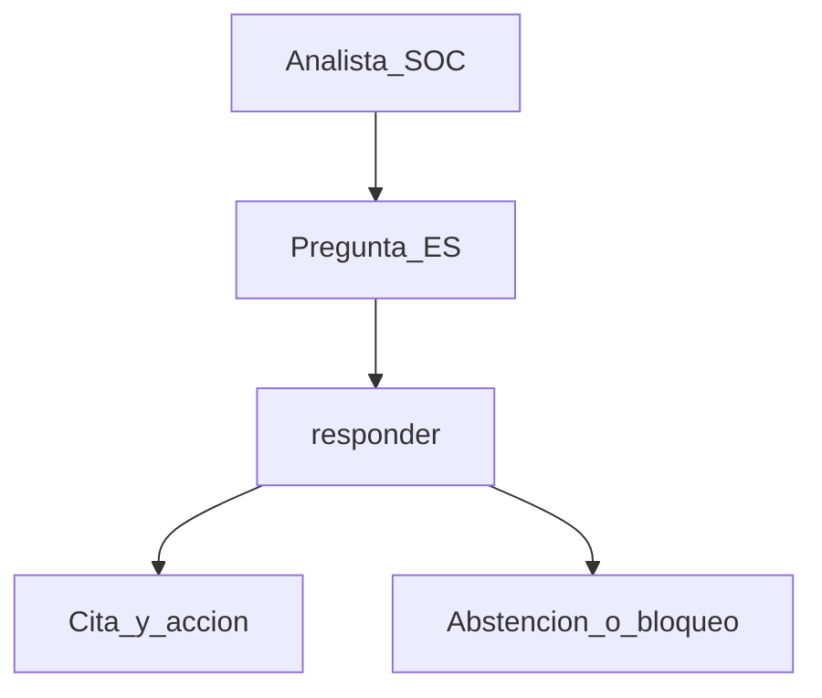

# Guía del analista (1 página)

## Qué puede preguntar
- CVE del índice: ¿está en KEV? ¿banda SOC? ¿táctica ATT&CK?
- Técnica ATT&CK (`Txxxx`): ¿cómo detectar? (solo con evidencia del índice)
- Gobierno: ¿usar datos sintéticos de Kaggle para priorizar? → **no**

## Qué debe aparecer en la respuesta
1. **Veredicto** con identificador citado (`CVE-…` o `T….`)
2. **Evidencia** del documento recuperado (CVSS, KEV, táctica, extracto)
3. **Acción** defensiva
4. **Límite**: no sustituye SIEM; no afirma explotación en su red

## Cuándo se abstiene
- Identificador ausente del índice (p. ej. CVE inventado)
- Coseno del bi-encoder < 0,40 sin ancla de id

## Qué no pide
Procedimientos ofensivos, exploits, pasos de ataque. El asistente los rechaza.

