# Reporte de datos — Análisis exploratorio (Fase 2)

**Proyecto:** Asistente de apoyo a *threat hunting* basado en LLM y CTI  
**Autor:** David Martínez — UNAL, Diplomado ML 2026-II  
**Metodología:** TDSP — etapa *Adquisición, comprensión, preprocesamiento y EDA*  
**Código reproducible:** `scripts/preprocessing_eda/Proyecto_Fase2_ThreatIntel_EDA.ipynb` (incluye **análisis de resultados** en markdown bajo cada sección ejecutada)  
**Figuras:** `docs/data/figures/`

---

## Resumen general de los datos

El proyecto integra **cinco tablas lógicas** provenientes de dos fuentes públicas:

| Conjunto | Fuente | Observaciones | Variables | Rol en el proyecto |
|--------|--------|---------------|-----------|-------------------|
| `cve_data` | Hugging Face | 5 000 | 28 | Núcleo CVE/CVSS/KEV para RAG y priorización |
| `mitre_attack` | Hugging Face | 697 | 11 | Taxonomía ATT&CK y detección |
| `instructions_train` | Hugging Face | 14 189 | 3 | Supervisión / fine-tuning |
| `instructions_test` | Hugging Face | 1 577 | 3 | Evaluación hold-out |
| Kaggle CTI 2026 | Kaggle CSV | 50 000 | 15 (+ `incident_date` en ETL) | EDA tabular y variable objetivo `severity_level` |

**Tipos de variables:** en HF `cve_data`, el Parquet original expone todo como **string**; tras el preprocesamiento hay **fechas**, **float**, **boolean** y **categóricas**. En Kaggle predominan **enteros**, **float** y **categóricas** ya tipadas.

**Valores faltantes:** el CSV de Kaggle no presenta nulos en ninguna columna (0 % verificado). En `cve_data` no hay nulos en columnas críticas. En `mitre_attack`, el literal `"nan"` del origen dejaba **`detection` 100 % nulo** en el parquet limpio; tras hardening STIX (`*_hardened.parquet`) queda **0 % nulo** (strategies + analytics).

**Ratio train/test (`instructions`):** 14 189 / 1 577 = **9,00:1**.

---

## Idioma del corpus y estrategia multilingüe (ES)

Auditoría §3.1 (gate 24/11/2026; **`langdetect` activo**, pin `requirements.txt`: `>=1.0.9,<1.1`):

| Campo | Muestra | en | otro |
|-------|--------:|---:|-----:|
| `cve_data.description` | 800 | **99,9 %** | da 0,1 % |
| `mitre_attack.description` | 400 | **100 %** | — |
| `instructions.instruction` | 1000 | **100 %** | — |
| `instructions.output` | 1000 | **100 %** | — |

**Implicación:** datos en inglés; el asistente debe **responder en español** (Fase 3: *system prompt*, RAG, QLoRA) sin traducir masivamente el corpus en Fase II.

---

## Desbalance por fuente (§4.2)

| Fuente | Variable | Hallazgo cuantitativo | ratio max/min |
|--------|----------|----------------------|---------------|
| CVE | `cvss_severity` | CRITICAL **4944 (98,88 %)**; HIGH/MEDIUM 26 c/u; LOW 4 | **1236** |
| CVE | `risk_level` | CRITICAL **4051 (81,02 %)**; HIGH **923 (18,46 %)** | **2025,50** |
| CVE | `in_cisa_kev` | True **92 (1,84 %)** | **53,35** |
| CVE | `exploit_available` | True **4081 (81,62 %)** vs False 919 | 4,44 |
| CVE | `likely_mitre_tactic` | Unknown **1977 (39,54 %)** en clean; tras hardening **16,5 %** Unknown | **94,14** (pre) |
| MITRE | `tactic_primary` | Stealth **148 (21,23 %)** … Initial Access 15 (2,15 %) | **9,87** |
| MITRE | sub-técnicas | **475 (68,15 %)** vs padre 222 (31,85 %) | 2,14 |
| Kaggle | `severity_level` | High/Low/Medium/Critical **25,04 / 25,02 / 24,98 / 24,95 %** | **1,00** |
| Kaggle | `attack_type` / `detection_method` | ~16,4–17,0 % c/u | 1,03 |
| instructions | `task_type` (heurístico) | train: other **36,27 %**, remediation 32,20 %, detection **1,01 %** | 35,74 |
| instructions | split | train/test **9,00:1**; proporciones alineadas | — |

**Lectura SOC:** 81,62 % con exploit vs 1,84 % KEV → no priorizar solo por CVSS/exploit. **Decisión Fase II:** sin SMOTE; mitigación en Fase 3 (PR-AUC/recall KEV, stratify, prompt routing).

---

## Resumen de calidad de los datos

| Control de calidad | Resultado | Acción aplicada |
|--------------------|-----------|-----------------|
| Duplicados `cve_id` | 0 | Regla `drop_duplicates` defensiva |
| Duplicados `technique_id` | 0 | Idem |
| Duplicados `incident_id` | 0 | Idem |
| `description` CVE únicas | 4902 / 5000 | 98 textos repetidos |
| `instructions` duplicadas (train) | 14160 / 14189 | ~99,8 % plantillas `instruction` |
| Diversidad léxica `output` (train) | 0,0102 | Corpus muy repetitivo |
| Nulos Kaggle | 0 % en 15 columnas | Sin imputación necesaria |
| Consistencia booleana HF | Valores `True`/`False` como string | Mapeo a `bool` |
| Fechas HF | Strings ISO | `pd.to_datetime` |
| Scores CVSS / riesgo | Strings numéricos | `pd.to_numeric` |
| Mes inválido | No detectado | `clip(1, 12)` en ETL Kaggle |
| Outliers financieros / usuarios | Colas amplias (ver descriptivos) | Documentados; sin recorte en Fase 2 (decisión de negocio para Fase 3) |

**Conclusión de calidad:** los conjuntos son **aptos para EDA y modelado prototipo**; la principal precaución es el **sesgo de severidad** en `cve_data` (casi todo CRITICAL) y patrones de **uniformidad** en Kaggle (severidad ~25 % c/u, correlaciones |r|≤0,01, proporciones industria×severidad ~0,24–0,26), inferidos de las cifras — no de metadatos del proveedor.

---

## Variable objetivo

Se definen **dos objetivos** según la capa de análisis:

### 1. Tabular (Kaggle) — `severity_level`

Distribución **casi uniforme** (diseño del dataset):

| Nivel | Conteo | % aprox. |
|-------|--------|----------|
| High | 12 522 | 25.0 % |
| Low | 12 511 | 25.0 % |
| Medium | 12 492 | 25.0 % |
| Critical | 12 475 | 25.0 % |

**Impacto medio por severidad** (no separa claramente los grupos — señal débil para regresión/clasificación simple):

| Severidad | Pérdida media (M USD) | Tiempo respuesta medio (h) |
|-----------|----------------------:|---------------------------:|
| Critical | 2,52 | 36,40 |
| High | 2,50 | 35,82 |
| Medium | 2,50 | 36,40 |
| Low | 2,52 | 35,96 |

**Chi-cuadrado vs `severity_level` (α=0,05):** solo `detection_method` significativo (**p=0,0285**); `attack_type` **p=0,6727**.

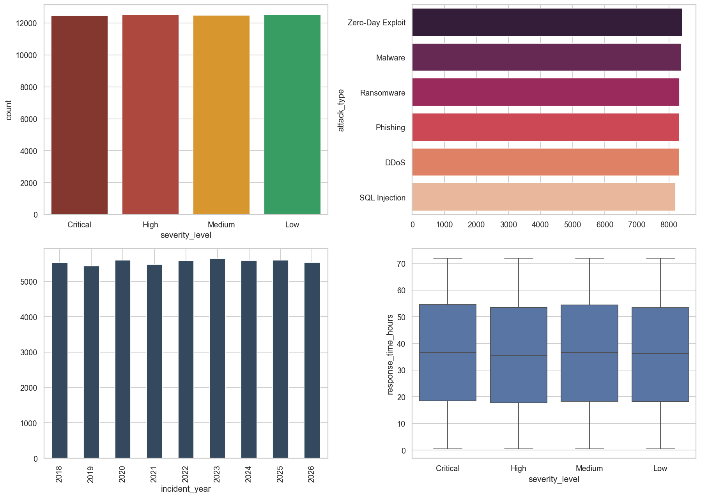

*Figura 1. Severidad, tipos de ataque, tendencia temporal y tiempo de respuesta por severidad.*

### 2. CVE (Hugging Face) — `risk_level` / `cvss_severity`

| Campo | Distribución destacada |
|-------|------------------------|
| `cvss_severity` | CRITICAL: 4 944; HIGH: 26; MEDIUM: 26; LOW: 4 |
| `risk_level` | CRITICAL: 4 051; HIGH: 923; MEDIUM: 24; LOW: 2 |
| `in_cisa_kev` | True: 92 (1.8 %); False: 4 908 |
| `cvss_score` (numérico) | Media ≈ **9.73**; sin fallos de conversión |

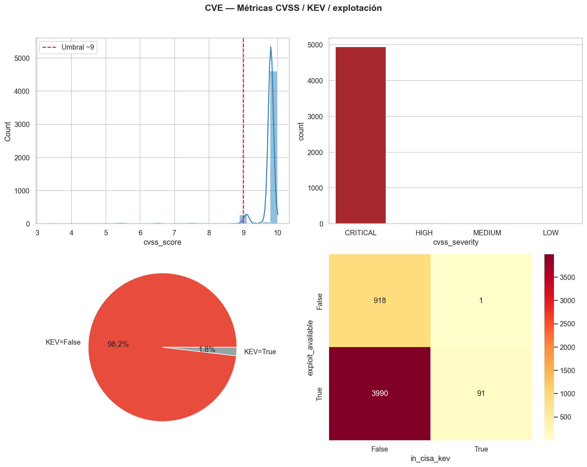

*Figura 2. Distribución CVSS, severidad, catálogo CISA KEV y cruce explotación pública vs KEV.*

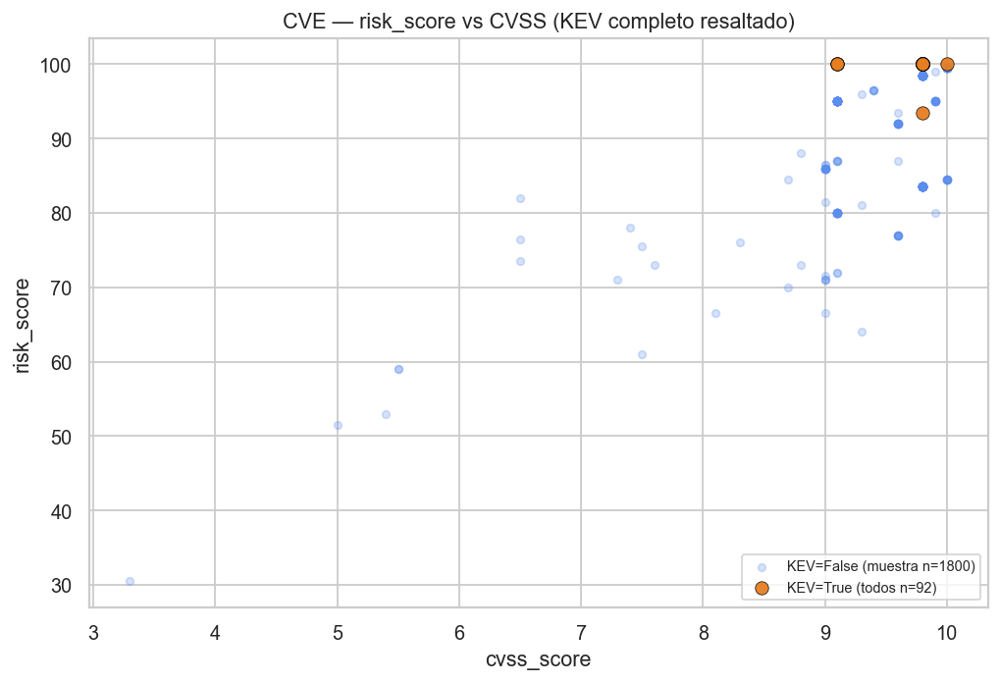

*Figura 3. Validación de la puntuación compuesta; **todos los KEV (n=92)** resaltados sobre muestra no-KEV.*

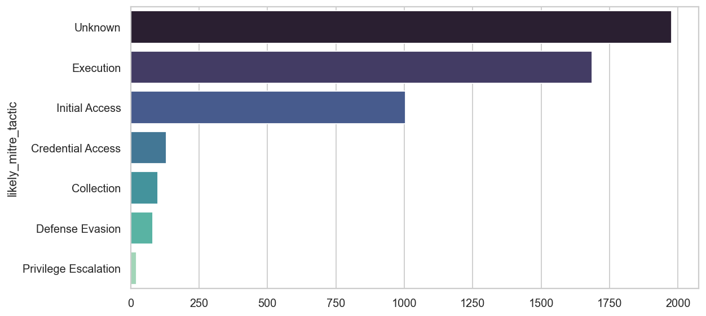

*Figura 4. Frecuencia de tácticas en parquet **clean** (~**39,5 %** Unknown). Tras hardening, `likely_mitre_tactic_enriched` deja residual **16,5 %** Unknown (ver `hardening_cti_impact.png`).*

- **Explotación pública:** 4 081 CVE (**81,62 %**) con `exploit_available=True`.
- **Cruce exploit × KEV:** 3990 (exploit sí, KEV no); 91 (ambos); 918 (ninguno); 1 (KEV sin exploit público en muestra).

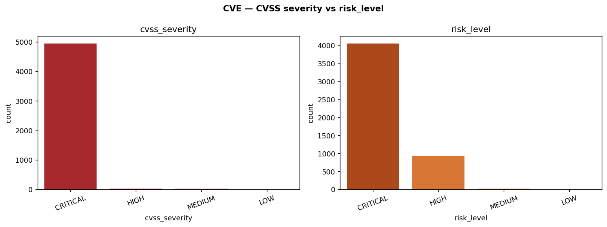

**Implicación para el asistente LLM:** el modelo debe **explicar y priorizar** dentro de un universo ya filtrado hacia alto riesgo; las señales discriminantes estarán en texto (`description`, `likely_mitre_tactic`), KEV y pares `instructions_*`, no solo en `cvss_severity`.

---

## Variables individuales

### Kaggle — variables numéricas (estadísticos principales)

| Variable | Media | Desv. est. | Mín | Máx |
|----------|-------|------------|-----|-----|
| `affected_users_count` | 50 012 | 28 825 | 11 | 99 992 |
| `estimated_financial_loss_usd` | 2 510 816 | 1 440 451 | 1 218 | 4 999 963 |
| `vulnerability_score` | 5.51 | 2.59 | 1.0 | 10.0 |
| `response_time_hours` | 36.14 | 20.70 | 0.5 | 72.0 |
| `systems_affected_count` | 250.0 | 143.88 | 1 | 499 |
| `incident_year` | 2022.0 | 2.58 | 2018 | 2026 |

### Kaggle — variables categóricas (patrones)

- **`attack_type` (top 5):** Zero-Day Exploit (8 425), Malware (8 381), Ransomware (8 337), Phishing (8 324), DDoS (8 318) — diseño equilibrado.
- **`country` (top 5):** Canada, Australia, USA, UK, India (~8.2k registros c/u).
- **`industry` (top 5):** Technology, Government, E-commerce, Education, Healthcare.
- **`detection_method`:** SIEM (8 489), Firewall (8 455), Antivirus (8 378), AI Detection (8 253), IDS (8 217), Manual Review (8 208).

**Transformaciones recomendadas (Fase 3):** *one-hot* o *target encoding* para categóricas de alta cardinalidad; escalado de numéricas si se usan modelos lineales; **no** es necesario imputar nulos.

### HF `cve_data` — variables clave

- **Texto largo:** `description`, `affected_products`, `reference_urls` → chunking para embeddings (RAG).
- **Categóricas CVSS:** `attack_vector`, `attack_complexity`, etc. → útiles como *features* explicativas en modelos tabulares auxiliares.
- **Señal operativa:** `in_cisa_kev` (minoritario pero crítico para priorización CISO).

### NLP sobre `description` CVE (§6.2)

| Métrica | mean | mediana | max | Nota |
|---------|-----:|--------:|----:|------|
| `n_tokens` | 44,07 | **36** | 450 | Sesgo a la derecha; IQR ~25–53 |
| `n_lemma` | 25,55 | 22 | 264 | |
| `n_cve_refs` | 1,35 | **0** | 48 | **75 %** sin refs en texto |
| `spelling_var` | 0,14 | 0,13 | 0,61 | |

- **KEV vs no-KEV (boxplots):** mediana de tokens KEV ligeramente mayor (~45–50 vs ~36); outliers extremos (hasta 450) en no-KEV. La señal KEV **no** es longitud textual.
- **TF-IDF:** unigramas top `remote`, `via`, `allows`, `attackers`; bigramas `remote attackers`, `sql injection`, `buffer overflow`, `arbitrary code`; sesgo léxico **`2016` / `php`**.
- **Similitud coseno (muestra):** fondo ~0–0,2 con micro-clusters de plantillas; KEV no forma bloque lingüístico aparte.

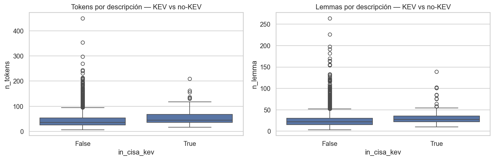

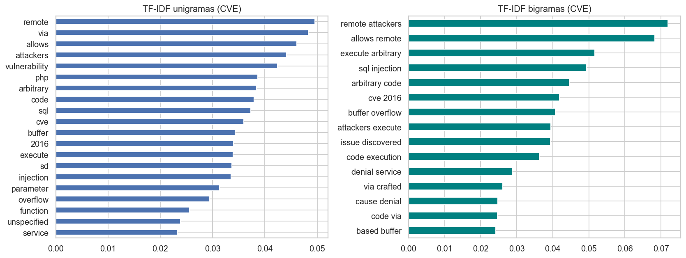

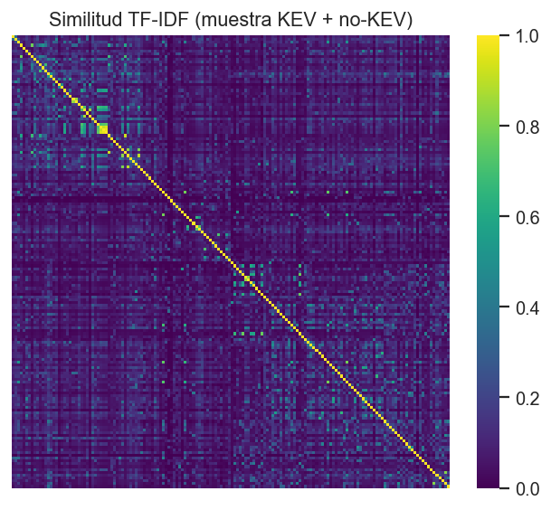

### HF `instructions_*`

| Métrica (tokens medios) | train | test |
|-------------------------|------:|-----:|
| `instruction_ntok` | 9,52 | 9,45 |
| `input_ntok` | 39,04 | 39,43 |
| `output_ntok` | 91,30 | 91,18 |

- Similitud TF-IDF media: instruction–input **0,113**; input–output **0,214**.
- Instrucciones duplicadas: train **14160/14189**; diversidad léxica output train **0,0102**.
- **Variable objetivo textual:** `output` (inglés en corpus; respuesta objetivo **español** en Fase 3).

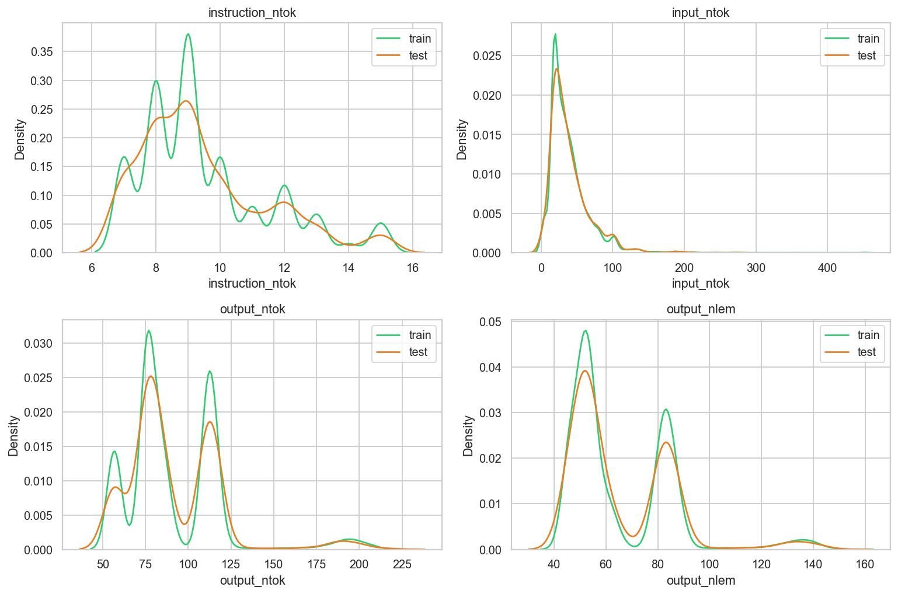

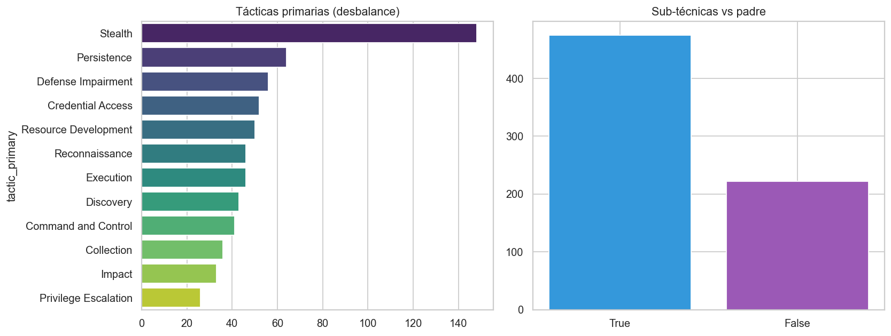

### NLP / embeddings MITRE (§7)

**TF-IDF por táctica (pesos de la ejecución):**
- Stealth: `code` **0,1515**, `process` **0,0882**, `malicious` 0,0618.
- Persistence: `code` **0,1085**, `accounts` **0,0505**, `service` **0,0468**.
- Defense Impairment: `network` **0,0701**, `cloud` **0,0636**, `security` **0,0500**.

**W2V vecinos de `execution` (similitud, gate 24/11):** `executing` 0,983 · `mavinject` 0,980 · `inject` 0,978 · `verclsid` 0,977 · `odbcconf` 0,976 · `binary` 0,976 · `arbitrary` 0,975 · `script` 0,975.

**PCA (centroides):** Execution↔Stealth próximos; **Reconnaissance** outlier léxico. Sub-técnicas **68,15 %** → indexar padre↔hijo en RAG.

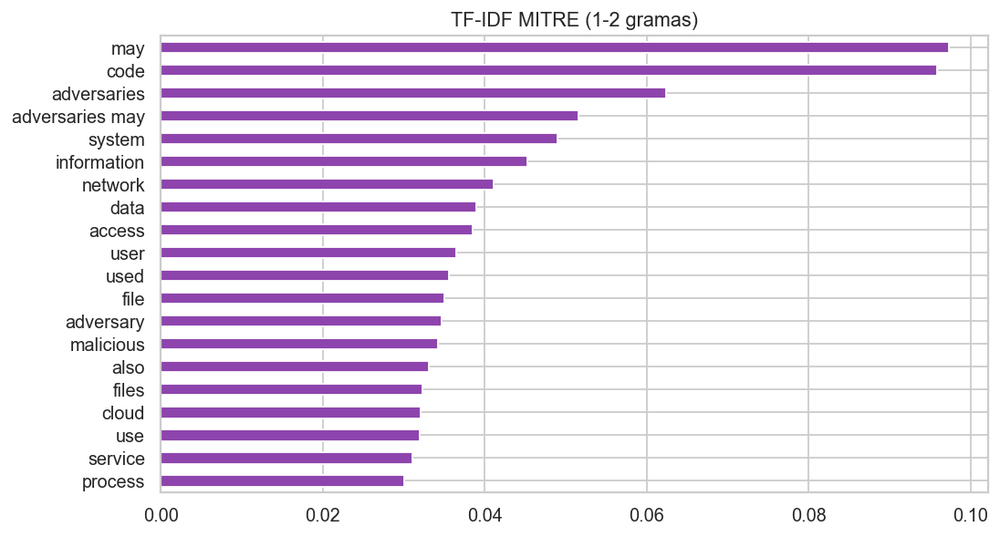

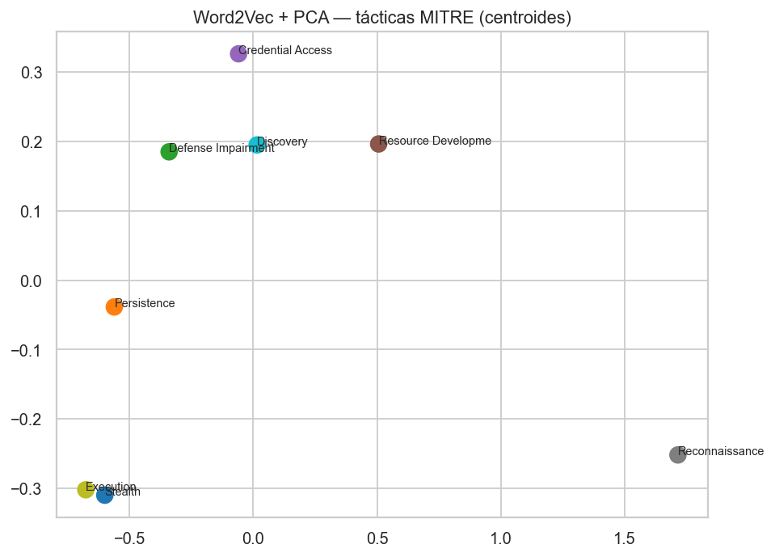

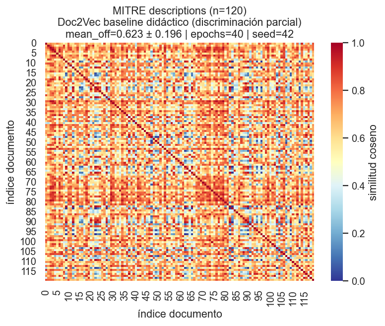

*Doc2Vec MITRE (reintento n=120, epochs=40): mean_off ≈ **0,62** → discriminación parcial; baseline didáctico, no índice de producto.*

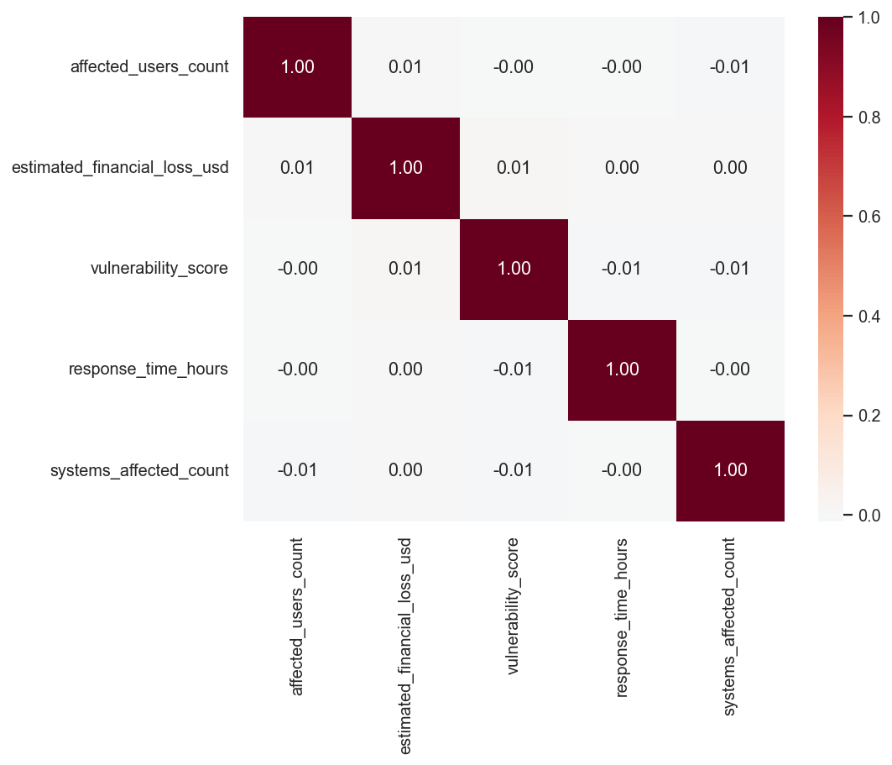

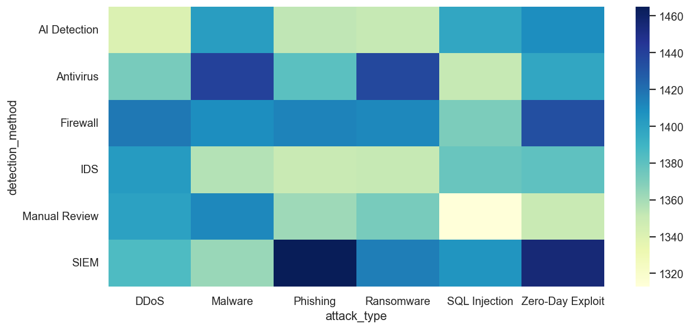

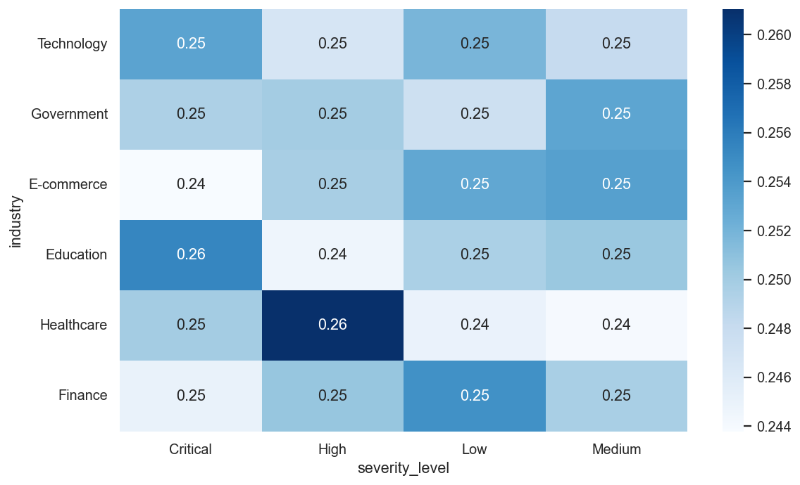

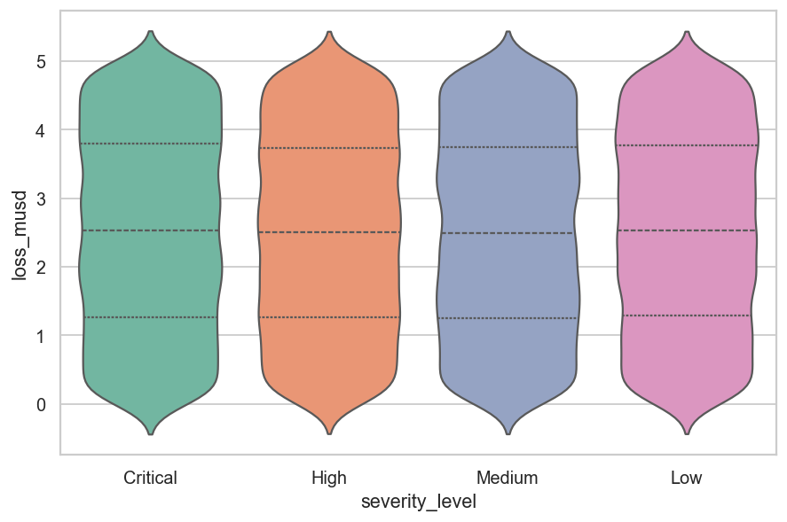

---

## Ranking de variables

### Correlación (solo numéricas Kaggle)

Las correlaciones lineales son **prácticamente nulas** (|r| < 0.02), lo que indica que las variables numéricas del CSV **no se relacionan linealmente** entre sí en este dataset sintético:

| Par más alto | r aprox. |
|--------------|----------|
| `affected_users_count` ↔ `estimated_financial_loss_usd` | 0.01 |
| `vulnerability_score` ↔ `estimated_financial_loss_usd` | 0.01 |
| `incident_year` ↔ `response_time_hours` | -0.02 |

**Ranking cualitativo para predecir `severity_level` (hipótesis, a validar en modelado):**

1. `attack_type`, `attack_vector` (semántica de amenaza)
2. `vulnerability_score`
3. `detection_method`, `response_action_taken`
4. Variables de impacto (`affected_users_count`, `estimated_financial_loss_usd`) — baja separación empírica entre severidades
5. `incident_year`, `incident_month` (estacionalidad débil)

**Para priorización CVE (`risk_level` / KEV):**

1. `in_cisa_kev`, `exploit_available`
2. `cvss_score`, `risk_score`
3. `likely_mitre_tactic`
4. Texto de `description` (embeddings)

*La importancia formal (Random Forest, SHAP, mutual information) se calculará en la fase de modelamiento.*

---

## Relación entre variables explicativas y variable objetivo

### Kaggle

- No hay correlación numérica fuerte con `severity_level`.
- Los gráficos de caja muestran **medias de `response_time_hours` similares** entre Critical, High, Medium y Low → la severidad etiquetada **no está codificada** en tiempo de respuesta ni en pérdida financiera en este CSV.
- La relación esperada es **no lineal y multicategórica**: modelos basados en árboles o LLM con contexto tabular pueden capturar interacciones (`attack_type` × `industry`) que la correlación de Pearson no revela.

### HF `cve_data`

- `cvss_score` alto concentra `cvss_severity = CRITICAL`.
- `in_cisa_kev = True` implica urgencia operativa (patch inmediato) aunque sea minoritario.
- `likely_mitre_tactic` enlaza con `mitre_attack` para explicabilidad del asistente (“esta CVE se asocia a táctica X”).

### Integración de fuentes (visión del asistente)

| Pregunta de negocio (Fase 1) | Evidencia en EDA |
|------------------------------|------------------|
| ¿Qué vulnerabilidades son más graves o explotadas? | `cvss_score` alto, 1.8 % en KEV, `risk_level` CRITICAL dominante |
| ¿Relación CVE ↔ tácticas? | Campo `likely_mitre_tactic` + tabla `mitre_attack` |
| ¿Patrones agregados de amenaza? | Kaggle: equilibrio de `attack_type` y `severity_level` |
| ¿Datos para entrenar respuestas de analista? | 14k+ pares en `instructions_train` |

---

## Conclusiones clave

1. **Dos mundos complementarios:** HF aporta **conocimiento técnico de vulnerabilidades y MITRE**; Kaggle aporta **contexto operativo de incidentes** sintéticos. El asistente LLM deberá combinar RAG sobre CVE/MITRE con razonamiento sobre tablas de incidentes.
2. **Calidad alta en completitud**, con atención a tipos (HF) y literales `nan` en MITRE.
3. **Sesgo de severidad en `cve_data`:** casi todo es CRITICAL; el valor del modelo está en **texto, KEV y enlaces MITRE**, no en discriminar HIGH vs CRITICAL por score solo.
4. **Kaggle balanceado y poco correlacionado:** ideal para practicar pipelines TDSP y clasificación, pero las métricas pueden ser **optimistas**; validar con datos reales en fases futuras.
5. **Próximos pasos (Fase 3):** embeddings + índice vectorial (CVE/descripciones), baseline de clasificación de `severity_level`, y evaluación en `instructions_test` con métricas de similitud o revisión humana.

---

## Referencias de artefactos generados

| Artefacto | Ruta |
|-----------|------|
| Parquet CVE limpio | `data/processed/cve_data_clean.parquet` |
| Parquet MITRE limpio | `data/processed/mitre_attack_clean.parquet` |
| Parquet Kaggle limpio | `data/processed/kaggle_cti_2026_clean.parquet` |
| Notebook ETL + EDA | `scripts/preprocessing_eda/Proyecto_Fase2_ThreatIntel_EDA.ipynb` |
| Definición y diccionario | `data_definition.md`, `data_dictionary.md` |

---

## Puente CVE ↔ MITRE (proporciones)

**Pre-hardening** (`likely_mitre_tactic` en clean):

| Táctica | cve_share | mitre_share |
|---------|----------:|------------:|
| Unknown | 0,3954 | 0,0000 |
| Execution | 0,3372 | 0,0660 |
| Stealth | 0,0000 | 0,2123 |

**Post-hardening:** Unknown residual **0,1648** en `likely_mitre_tactic_enriched` (CWE+keywords). No comparar directamente proporciones entre fuentes (taxonomías distintas).

---

## Autoevaluación frente a la rúbrica (Fase 2 — 10 %)

| Criterio nota **4,0–5,0** | Estado | Evidencia |
|---------------------------|--------|-----------|
| Preprocesamiento (ETL, calidad) | **Cumple** | §4–§5; **7** parquets en `data/processed/` (clean + hardened + instructions) |
| EDA (estadísticos + visualizaciones + NLP) | **Cumple** | §6–§9; **29 PNG** en `docs/data/figures/` (gate visual) |
| Definición de datos | **Cumple** | `data_definition.md`, `data_dictionary.md` |
| Reporte + conclusiones **basadas en datos** | **Cumple** | Este archivo + celdas *Análisis de resultados* (Hechos / Interpretación / Implicación / Limitaciones) |
| Reproducibilidad | **Cumple** | nbconvert end-to-end 24/11/2026, 0 errores; `langdetect` activo; rutas raíz TDSP |

**Nota estimada (autoevaluación gate + registro Fase_III/09–11):** **5,0 / 5,0** (técnica TDSP). Entrega admin curso (commit/captura) aparte.

---

## Hardening CTI (Fase 2b → listo Fase 3)

Ejecutado con `scripts/preprocessing_eda/harden_fase2_cti.py` + notebook `Proyecto_Fase2b_Hardening_CTI.ipynb`.

| Mejora | Antes | Después |
|--------|------:|--------:|
| `mitre.detection` nulo | 100 % | **0 %** (STIX oficial) |
| CVE `likely_mitre_tactic = Unknown` | 39,5 % | **16,5 %** (CWE+keywords) |
| Instructions en parquet | No | `instructions_{train,test}_clean.parquet` |
| Score SOC | No | `soc_priority_score` / `soc_priority_band` (playbook) |
| Gold set ES | No | 40 ítems en `docs/data/evaluation/gold_set_es.json` |
| Retrieval baseline | No | MiniLM MRR **0,19**; R@5 **0,25**; R@10 **0,28** |
| Linaje | No | `data/raw/manifest.json` (sha256) |
| Guardrails / datasheet / tono ES | No | `assistant_guardrails.md`, `datasheet.md`, `tone_guidelines_es.md` |

**Lectura crítica:** el retrieval aún es débil (R@5=0,25) → Fase 3 debe mejorar embeddings/re-ranker **antes** de confiar en generación libre; la política de abstención (similitud &lt; 0,25) es obligatoria.

*Reporte Fase 2 — gate 24/11/2026 + hardening CTI el mismo día.*

---

## Gate visual Fase 2 (actualización)

Figuras regeneradas para honestidad metodológica:

| Figura | Cambio |
|--------|--------|
| `etl_imbalance_cve_ratios.png` | **Conteos por clase** (ya no repite el mismo ratio en cada etiqueta) |
| `etl_imbalance_cve_variable_ratios.png` | Ratio max/min **1 barra = 1 variable** |
| `etl_imbalance_mitre_ratios.png` | Conteos táctica + sub-técnica |
| `hf_cve_risk_vs_cvss.png` | **Todos los KEV (n=92)** resaltados sobre muestra no-KEV |
| `mitre_doc2vec_sim.png` / `inst_doc2vec_sim.png` | Reintento Doc2Vec: mean_off ~0,62 / 0,72 → **discriminación parcial**; baseline **didáctico** (no producto) |
| `hardening_cti_impact.png` | Unknown 39.5%→16.5%; detection null 100.0%→0.0% |

**KDE instructions:** picos en **tokens** (`output_ntok` ~60/80/115), no caracteres.

**PCA Kaggle:** var. expl. ~40 %; elbow **sin codo claro**; `loss_musd` idéntica entre severidades (dato sintético).

**Corpus LLM — detection:** `task_type=detection` ≈ **144** (~1 %) → no entrena “cómo detectar”; usar MITRE hardened + RAG (`Fase_III/`).

**NLP clásico (TF-IDF/W2V/Doc2Vec):** baseline **didáctico**. Retrieval de producto: MiniLM/hybrid (MRR~0.19, R@5~0.25) a mejorar en Fase 3.

---

## Baselines Módulo 4 (complemento Fase 2c)

Alineados a MLDS4 U4 (supervisado) y U5 (tópicos). Script: `run_m4_classic_baselines.py` · notebook: `Proyecto_Fase2c_M4_Clasico.ipynb` · KB: `docs/knowledge/`.

| Experimento | Dato | Lectura honesta |
|-------------|------|-----------------|
| TF-IDF→LR `task_type` (instructions) | acc **0,938** · macro-F1 **0,925** | Etiqueta **heurística** (keywords); no gold humano — baseline de curso |
| LR tabular Kaggle `severity_level` | acc **0,253** · macro-F1 **0,169** | Casi azar → confirma datasheet (señal sintética débil) |
| LDA/NMF CVE+MITRE | n_docs≈**3696**, k=**6** | Temas léxicos (code/remote/exploit…); no = ATT&CK |

Figuras: `m4_lr_task_type_cm.png`, `m4_lr_kaggle_severity_cm.png`, `m4_topics_cve_lda.png`.
