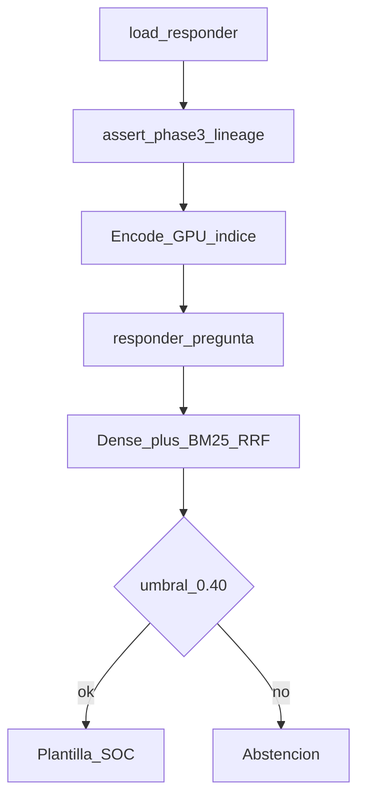

# Despliegue del asistente — ejecutado

Estado: **ejecutado** (2026-11-25T05:44:23+00:00).

## Qué se despliega

- **Nombre:** asistente CTI de dos épocas, fusión RRF, plantilla en español.
- **Checkpoint:** `artifacts/fase3/biencoder_best` (`lr1e-04_ep2`).
- **Forma:** bi-encoder siamés (MiniLM) + BM25 (`k1=1,5`, `b=0,75`) + RRF k=60.
- **API:** `from threatintel.rag.responder import responder` → `responder(pregunta)`.
- **Plataforma:** proceso local. Sin API pública.
- **Índice:** parquets hardened únicamente (compuerta de linaje al arrancar).
- **Fuera:** `biencoder_ep3`, re-ranker, bonus KEV de ranking, fusión lineal.



## Requisitos

- Python 3.13 + `requirements.txt`.
- GPU opcional para encode; la demo no reentrena.

## Ejecución

```bash
set PYTHONPATH=src
python -u -m threatintel.rag.run_fase4
```

Salida S1–S5: `docs/acceptance/fase4_demo_s1_s5.md`. Media checklist: **5.00/5**.

## Uso previsto

Pregunta en español por CVE/técnica del índice. Abstención si falta id o coseno < 0,40. Pedido ofensivo sin procedimiento.

## Mantenimiento

No se reabre la grilla ni se sustituye el checkpoint con candidatos. Un cambio de modelo exige otro conjunto de evaluación.
