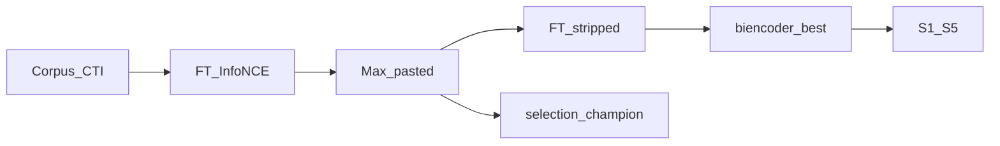

# Model report — Fase IV (TTP / TDSP)

TTP: campeón de SELECCIÓN pasted = DistilUSE confirm (MRR=0.765, IC95% [0.617, 0.892]). Campeón OPERATIVO ES = Strip lr1e-5 (stripped 0.325 vs DistilUSE 0.208; Δ pareado excluye 0=True). Deploy vigente = Strip (regla multi-objetivo declarada). Seeds strip pasted σ=0.012. Gold no eligió.

## Campeones

| Rol | Checkpoint | Métrica de elección |
|-----|------------|---------------------|
| Selección (pasted) | `artifacts/fase4/candidates/confirm_distiluse_ep1_ep2` (+ copia `biencoder_selection_champion`) | max MRR pasted |
| Operativo ES / deploy | `artifacts/fase4/biencoder_best` = strip_from_f4_lr1e-5 | stripped +1pp y pasted ≥ −3pp |

## Por qué Deep Learning

BM25/TF-IDF no alinean pregunta en español con advisory en inglés sin extracto. El bi-encoder InfoNCE aprende esa transferencia; RRF combina señal léxica + densa.

## Ajuste correcto (anti-sobreajuste)

- DistilUSE ep3 < ep2 → no se promueve.
- Hardneg BM25/denso y seq384 no superan confirm pasted.
- Continue lr bajo no supera confirm.
- Strip sc10 sube stripped a 0,382 pero tumba pasted fuera de regla → rechazado.

## TTPs de ciencia de datos aplicadas

1. Splits fijos + semilla; gold hold-out solo reporta.
2. Grilla HP con rechazo explícito.
3. Bootstrap 95% CI y deltas pareados.
4. Análisis por familia y distribución de rangos.
5. Curvas Recall@k y calibración de umbral.
6. Estabilidad multi-semilla.
7. Frontera Pareto multi-objetivo.

Figuras: `docs/data/figures/fase4_ttp_*.png`. JSON: `docs/data/evaluation/fase4_ttp_pack.json`.