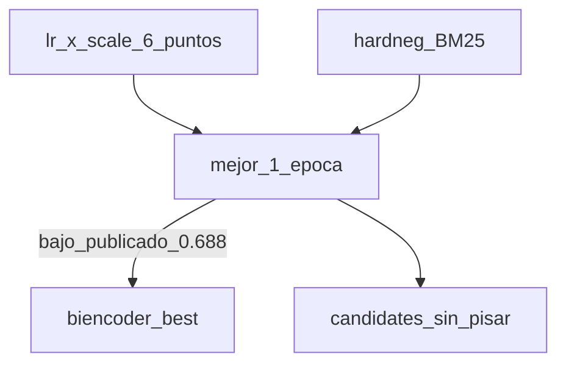

# Hiperparámetros del modelado

Búsqueda de un factor a la vez. La métrica es el MRR de desarrollo sin identificador. El gold no se consultó.

ep3 llega a 0.752 en dev, por encima de 0.688. Queda como candidato y no pisa biencoder_best: el gold ya se había abierto y no desempató esta búsqueda.

Mejor corrida de una época en este barrido: `batch_16` con MRR 0.671. La referencia de una época en la grilla es 0.652. La de dos épocas, publicada, es 0.688.

## Entrenamiento

| Tag | Épocas | Lote | Longitud | Warmup | Weight decay | Scheduler | MRR sin id | R@5 sin id |
|-----|-------:|-----:|---------:|-------:|-------------:|-----------|-----------:|-----------:|
| batch_16 | 1 | 16 | 256 | 0.1 | 0.0 | linear | 0.671 | 0.767 |
| batch_64 | 1 | 64 | 256 | 0.1 | 0.0 | linear | 0.653 | 0.733 |
| seq_128 | 1 | 32 | 128 | 0.1 | 0.0 | linear | 0.668 | 0.700 |
| seq_384 | 1 | 32 | 384 | 0.1 | 0.0 | linear | 0.654 | 0.733 |
| warmup_0 | 1 | 32 | 256 | 0.0 | 0.0 | linear | 0.670 | 0.700 |
| warmup_020 | 1 | 32 | 256 | 0.2 | 0.0 | linear | 0.658 | 0.700 |
| wd_001 | 1 | 32 | 256 | 0.1 | 0.01 | linear | 0.652 | 0.733 |
| scheduler_cosine | 1 | 32 | 256 | 0.1 | 0.0 | cosine | 0.648 | 0.700 |
| ep3 | 3 | 32 | 256 | 0.1 | 0.0 | linear | 0.752 | 0.833 |
| confirm_batch_16 | 2 | 16 | 256 | 0.1 | 0.0 | linear | 0.662 | 0.700 |

## BM25

Publicado: k1=1,5 y b=0,75, MRR sin id 0.749. Mejor del tablero: k1=2.0 b=0.3, MRR 0.767.

| k1 | b | MRR sin id | R@5 sin id |
|---:|--:|-----------:|-----------:|
| 2.0 | 0.3 | 0.767 | 0.767 |
| 2.0 | 0.75 | 0.755 | 0.833 |
| 2.0 | 0.5 | 0.754 | 0.800 |
| 1.2 | 0.75 | 0.751 | 0.767 |
| 1.2 | 0.9 | 0.750 | 0.767 |
| 1.5 | 0.5 | 0.750 | 0.767 |
| 1.5 | 0.75 | 0.749 | 0.767 |
| 1.5 | 0.9 | 0.749 | 0.800 |
| 2.0 | 0.9 | 0.747 | 0.767 |
| 0.9 | 0.9 | 0.741 | 0.800 |
| 1.5 | 0.3 | 0.717 | 0.833 |
| 1.2 | 0.5 | 0.706 | 0.767 |
| 0.9 | 0.75 | 0.701 | 0.800 |
| 1.2 | 0.3 | 0.694 | 0.800 |
| 0.9 | 0.5 | 0.680 | 0.800 |
| 0.6 | 0.9 | 0.666 | 0.767 |
| 0.6 | 0.3 | 0.661 | 0.800 |
| 0.6 | 0.75 | 0.653 | 0.800 |
| 0.9 | 0.3 | 0.651 | 0.800 |
| 0.6 | 0.5 | 0.641 | 0.767 |

## Profundidad de la fusión

RRF con k=60 y el BM25 publicado.

| Top-k | MRR sin id | R@5 sin id |
|------:|-----------:|-----------:|
| 20 | 0.722 | 0.800 |
| 50 | 0.723 | 0.767 |
| 100 | 0.729 | 0.800 |
| 200 | 0.729 | 0.800 |

Figuras: `fase3_hp_recuperacion.png`, `fase3_hp_entrenamiento.png`.

## Candidato de tres épocas en el gold

Elegido en desarrollo (MRR sin identificador 0,752 en el barrido). La segunda corrida, la que quedó guardada en `artifacts/fase3/biencoder_ep3`, mide 0.729 en ese mismo desarrollo. El gold de abajo no se usó para elegirlo. `biencoder_best` sigue siendo el de dos épocas.

| Sistema | MRR gold, 2 épocas publicadas | MRR gold, 3 épocas | R@5, 3 épocas |
|---------|-------------------------------:|-------------------:|--------------:|
| bi-encoder | 0.890 | 0.683 | 0.781 |
| híbrido RRF | 0.953 | 0.964 | 1.000 |
| híbrido + re-ranker | 0.961 | 0.961 | 1.000 |

## Lectura para el despliegue

La tercera época mejora el desarrollo y empeora el encoder denso en el gold (0,890 a 0,683). La fusión RRF sube de 0,953 a 0,964 y el re-ranker se queda en 0,961. El desarrollo de la segunda corrida fue 0,729, no 0,752: con la misma semilla el punto se mueve unas centésimas.

Esa combinación es la firma de un encoder que se ajusta de más a las preguntas de desarrollo. El sistema que se entrega sigue siendo el de dos épocas. El candidato de tres épocas queda guardado para no perder la corrida, y no sustituye a `biencoder_best`.

## Interacción lr × loss_scale (1 época)

Métrica: MRR de desarrollo sin identificador. Semilla 42. `loss_scale` = 1/temperatura (InfoNCE / contrastive, M5U5).

| Tag | lr | scale | MRR sin id | R@5 |
|-----|---:|------:|-----------:|----:|
| lr2e-05_sc10 | 2e-05 | 10.0 | 0.608 | 0.733 |
| lr2e-05_sc20 | 2e-05 | 20.0 | 0.592 | 0.733 |
| lr2e-05_sc40 | 2e-05 | 40.0 | 0.553 | 0.667 |
| lr1e-04_sc10 | 0.0001 | 10.0 | 0.656 | 0.733 |
| lr1e-04_sc20 | 0.0001 | 20.0 | 0.652 | 0.733 |
| lr1e-04_sc40 | 0.0001 | 40.0 | 0.643 | 0.733 |

Hardneg BM25: MRR 0.678 (n=4000).

Mejor lr×scale en 1 época: lr1e-04_sc10=0.656 (referencia 1 época 0,652; publicado 2 épocas 0,688). Hardneg BM25 llega a 0.678 en desarrollo, aún por debajo del publicado 0,688. DistilUSE 1 época quedó en candidates/. No se pisa biencoder_best.

Figura: `docs/data/figures/fase3_hp_lr_scale.png`.

Figuras adicionales: `fase3_hp_delta_published.png` (Δ vs 0,688) y `fase3_hp_lr_scale.png` (heatmap).
