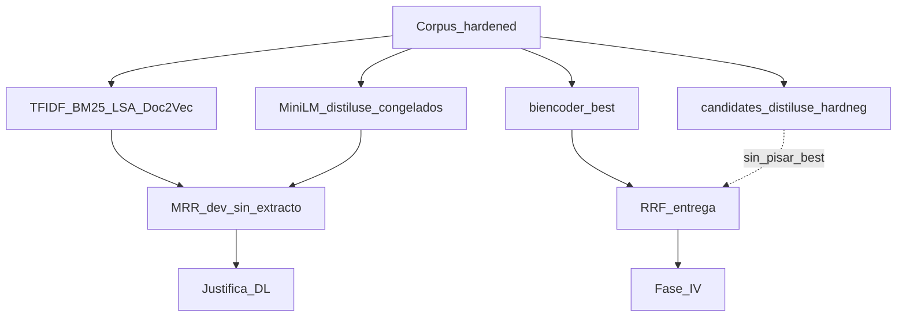
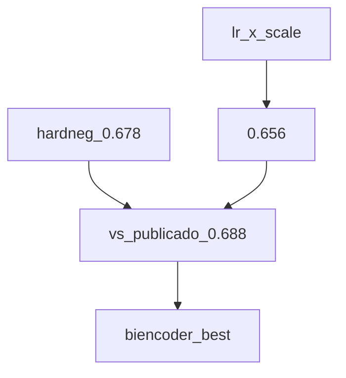

# Reporte del modelo final

## Resumen ejecutivo

El modelo es un bi-encoder multilingüe (`sentence-transformers/paraphrase-multilingual-MiniLM-L12-v2`) afinado con MultipleNegativesRankingLoss sobre el índice **hardened** (detection STIX completo y táctica enriquecida). El checkpoint elegido en dev, sin ver el gold, es `lr1e-04_ep2` (MRR dev sin identificador 0.688).

En el hold-out del protocolo de Fase II la fusión que se despliega (biencoder_ft + RRF, sin re-ranker) obtiene MRR 0.953 y Recall@5 1.000. Con re-ranker llega a 0.961; en paráfrasis ese re-ranker baja a 0.734, así que no entra en la respuesta. La fusión RRF en paráfrasis queda en MRR 0.953. Cumple la meta MRR ≥ 0,35 y Recall@5 ≥ 0,50.

TF-IDF, BM25 y la fusión lineal se midieron después, sin reentrenar, en la pregunta de desarrollo **sin** el extracto inglés pegado. La fusión lineal llega a 0.377 frente a 0.339 del RRF en esa métrica. Esos números son el **baseline del Módulo 4** (NLP clásico). No sustituyen al bi-encoder: la rúbrica exige el modelo de Deep Learning (siamesa + Transformer). Detalle en [`modelos_clasicos.md`](modelos_clasicos.md). Base de curso: [`../knowledge/base_curso_m4_m5.md`](../knowledge/base_curso_m4_m5.md).

Linaje de la corrida: detection nulo clean 100.0 % / hardened 0.0 %. Unknown original 39.5 %; residual enriquecido 16.5 %. El índice no leyó `*_clean`.

Abstención ante identificadores ausentes: 100.0 % (n=20). Coincidencia de cita con el gold original: 100.0 %. En paráfrasis: 62.5 %.

## Descripción del problema

El analista pregunta en español y el corpus está en inglés. Generar sin un índice útil inventa CVSS, KEV y detección. El fallo E18 de la Fase II mezcló el ETL limpio con el enriquecido; esta fase se niega a entrenar si eso vuelve a pasar.

No se optimiza la pérdida en dólares de Kaggle ni el accuracy de `severity_level`.

## Descripción del modelo

Torre siamesa, pooling del checkpoint base, coseno, InfoNCE con scale 20 (temperatura 0,05). No se entrena un transformer desde cero. El re-ranker `cross-encoder/mmarco-mMiniLMv2-L12-H384-v1` va congelado: es una ablación.

Hiperparámetros fijos: semilla 42, lote 32, longitud 256, warmup 10 %. Comparados: learning rate y épocas. La selección es el MRR de dev **sin** identificador. El mejor punto de la grilla supera al peor en 0.096 (lr1e-04_ep2 frente a lr2e-05_ep1). El encoder desplegado es `biencoder_ft` porque el checkpoint lr1e-04_ep2 superó al multilingüe congelado en MRR de dev sin identificador.

La compuerta se abstiene si el identificador no está en el índice, o si el coseno máximo queda bajo 0.40 (F1 de dev 1.000). La redacción rellena una plantilla en español solo con campos del documento recuperado.

## Evaluación del modelo

### Grilla en dev

| Configuración | lr | épocas | pérdida final | MRR dev sin id | R@5 dev sin id |
|---------------|---:|-------:|--------------:|---------------:|---------------:|
| lr2e-05_ep1 | 2e-05 | 1 | 0.102 | 0.592 | 0.733 |
| lr2e-05_ep2 | 2e-05 | 2 | 0.037 | 0.632 | 0.733 |
| lr1e-04_ep1 | 0.0001 | 1 | 0.060 | 0.652 | 0.733 |
| lr1e-04_ep2 | 0.0001 | 2 | 0.010 | 0.688 | 0.733 |

### Hold-out gold de Fase II

| Sistema | MRR | R@5 | MRR sin id | R@5 sin id |
|---------|----:|----:|-----------:|-----------:|
| minilm | 0.238 | 0.281 | n/d | n/d |
| bm25 | 0.396 | 0.500 | n/d | n/d |
| multi_frozen | 0.241 | 0.281 | n/d | n/d |
| biencoder_ft | 0.890 | 0.969 | n/d | n/d |
| hybrid_rrf | 0.953 | 1.000 | n/d | n/d |
| hybrid_rerank | 0.961 | 1.000 | n/d | n/d |
| hybrid_kev_boost | 0.827 | 0.969 | n/d | n/d |

### Paráfrasis sin identificador

Plantilla en español más extracto oficial. No entrenan ni eligen hiperparámetros. El extracto se solapa con el documento, así que BM25 puede verse fuerte sin que un analista haya parafraseado de memoria.

| Sistema | MRR | R@5 | MRR sin id | R@5 sin id |
|---------|----:|----:|-----------:|-----------:|
| minilm | 0.912 | 0.906 | 0.912 | 0.906 |
| bm25 | 0.944 | 1.000 | 0.944 | 1.000 |
| multi_frozen | 0.829 | 0.969 | 0.829 | 0.969 |
| biencoder_ft | 0.953 | 1.000 | 0.953 | 1.000 |
| hybrid_rrf | 0.953 | 1.000 | 0.953 | 1.000 |
| hybrid_rerank | 0.734 | 0.812 | 0.734 | 0.812 |
| hybrid_kev_boost | 0.839 | 1.000 | 0.839 | 1.000 |

### Citas, abstención y escenarios

| Control | Resultado |
|---------|-----------|
| Citas en contexto (gold respondido) | 100.0 % (n=30) |
| Citas del gold que coinciden con el documento | 100.0 % |
| Citas de paráfrasis que coinciden con el documento | 62.5 % |
| Abstención en id ausente | 100.0 % (n=20) |
| Abstención en consultas sin sentido | 100.0 % |
| Abstención falsa en gold factual | 6.2 % |
| Media del checklist, 5 escenarios | 5.00 |
| Media del checklist, muestra factual | 4.85 (n=20) |

| Escenario | Qué prueba | Ruta | Nota | Lectura |
|-----------|------------|------|-----:|---------|
| S1 | KEV y prioridad del día | retrieval | 5 | Cita el identificador esperado, con veredicto, acción y límite. |
| S2 | Táctica ATT&CK de un CVE | retrieval | 5 | Cita el identificador esperado, con veredicto, acción y límite. |
| S3 | Detección de una técnica | retrieval | 5 | Cita el identificador esperado, con veredicto, acción y límite. |
| S4 | Rechazo del dato Kaggle | datasheet | 5 | Respuesta de gobierno del proyecto, sin inventar un CVE. |
| S5 | CVE inventado | retrieval | 5 | Abstención explícita, sin asignar CVSS ni KEV al identificador ausente. |

El checklist es operativo. No es un estudio ciego entre analistas.

## Conclusiones y recomendaciones

La grilla cambia el MRR de dev, así que no se despliega la primera configuración. El boost KEV es una fila aparte: si no mejora el MRR, no reordena el índice; la banda se escribe en la respuesta. El re-ranker queda fuera de la respuesta: en el gold con identificador solo suma 0,008 de MRR y en las paráfrasis baja de 0,953 a 0,734.

Límites: gold factual pequeño y con el identificador en la pregunta; paráfrasis semi-sintéticas; sin telemetría real; sin QLoRA, EPSS ni CAPEC. El asistente no sustituye al SIEM y no confirma explotación en la red de quien pregunta.

## Referencias

- Karpukhin et al. (2020), Dense Passage Retrieval.
- Cormack, Clarke y Buettcher (2009), Reciprocal Rank Fusion.
- Playbook, guardrails y datasheet en `docs/data/`.
- `configs/retrieval.yaml`. Semilla 42.

## Sensibilidad y análisis de errores

El detalle, los intervalos y las ablaciones que no cambian el checkpoint están en [`sensibilidad.md`](sensibilidad.md). El modelo publicado sigue siendo el de la grilla.

## Barrido de hiperparámetros

El espacio que no estaba en la grilla ni en la sensibilidad está en [`hiperparametros.md`](hiperparametros.md). ep3 llega a 0.752 en dev, por encima de 0.688. Queda como candidato y no pisa biencoder_best: el gold ya se había abierto y no desempató esta búsqueda.

La interacción **lr × loss_scale** (1 época) y el negativo duro BM25 están en la misma nota, con heatmap `fase3_hp_lr_scale.png`. `loss_scale` = 1/temperatura (InfoNCE).

## Zoo de modelos

Baselines Módulo 4 (TF-IDF, BM25, LSA, Doc2Vec) y un segundo encoder (`distiluse`) en [`model_zoo.md`](model_zoo.md). Métrica de comparación: MRR en desarrollo **sin** extracto pegado. El gold solo se reporta.

| Sistema | MRR sin extracto | MRR gold |
|---------|-----------------:|---------:|
| Fusión lineal | 0,377 | 0,686 |
| RRF publicado | 0,339 | 0,953 |
| Bi-encoder 2 épocas | 0,198 | 0,890 |
| DistilUSE 1 época (candidato) | 0,196 | 1,000 |
| LSA / Doc2Vec | 0,113 / 0,034 | 0,142 / ~0 |

DistilUSE 1 época iguala casi al bi-encoder en stripped y reporta 1,000 en gold; **no** sustituye la entrega: el gold no elige y la rúbrica ya fijó el MiniLM + RRF publicado.

## Interacción lr × scale y hardneg

Seis puntos (lr ∈ {2e-5, 1e-4} × scale ∈ {10, 20, 40}) y negativo duro BM25. Mejor 1 época: `lr1e-04_sc10` = **0,656**. Hardneg = **0,678**. Publicado 2 épocas = **0,688**. Ninguno pisa `biencoder_best`. Detalle en [`hiperparametros.md`](hiperparametros.md).

## Cómo leer el notebook

Cada bloque experimental sigue: **código / salida de consola → markdown**. El markdown dice qué salió, qué significa, qué decide y qué no decide.

Figuras de decisión: `fase3_model_zoo.png`, `fase3_zoo_pareto.png`, `fase3_hp_lr_scale.png`, `fase3_hp_delta_published.png`, `fase3_rank_hist.png`, `fase3_bootstrap_delta.png`, `fase3_decision_deploy.png`, `fase3_decision_waterfall.png`.
