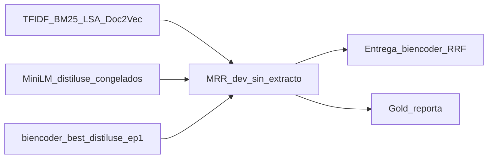
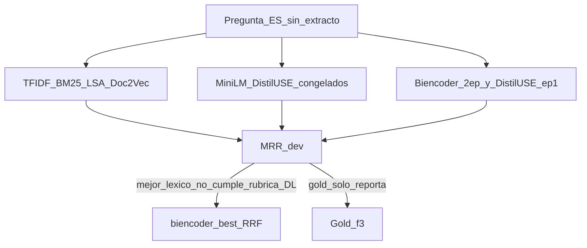

# Zoo de modelos — Fase III

Comparación en **desarrollo sin identificador y sin extracto pegado**. El gold se reporta una vez y no elige.

| Sistema | Familia | MRR sin extracto | R@5 | MRR gold |
|---------|---------|-----------------:|----:|---------:|
| BM25 | lexical | 0.375 | 0.400 | 0.398 |
| TF-IDF palabras | lexical | 0.303 | 0.367 | 0.906 |
| TF-IDF char | lexical | 0.252 | 0.267 | 0.958 |
| Fusión lineal | lexical | 0.377 | 0.400 | 0.686 |
| MiniLM congelado | dense_frozen | 0.144 | 0.167 | 0.238 |
| MiniLM multi congelado | dense_frozen | 0.070 | 0.067 | 0.241 |
| Bi-encoder 2 épocas | dense_ft | 0.198 | 0.300 | 0.890 |
| RRF publicado | hybrid | 0.339 | 0.367 | 0.953 |
| LSA (SVD 100) | unsupervised | 0.113 | 0.167 | 0.142 |
| Doc2Vec | embedding_classic | 0.034 | 0.033 | 0.001 |
| DistilUSE congelado | dense_frozen | 0.060 | 0.067 | 0.209 |
| DistilUSE 1 época | dense_ft | 0.196 | 0.267 | 1.000 |

En desarrollo sin extracto, LSA/Doc2Vec y léxicos miden el cruce español→inglés sin pegar el documento. DistilUSE afinado 1 época mejora el protocolo con extracto (MRR 0,722) y reporta gold 1,000; **el gold no elige** y el checkpoint queda en `artifacts/fase3/candidates/distiluse_ep1`. La entrega sigue siendo MiniLM bi-encoder + RRF.

Figura: `docs/data/figures/fase3_model_zoo.png`.

## Lectura para la decisión

Mejor léxico/clásico en sin-extracto: **0.377**. RRF en la misma métrica: **0.339**. La rúbrica de Fase III exige Deep Learning (siamesa + Transformer); por eso la entrega no cambia aunque el léxico gane en stripped.

Figuras de decisión:
- `fase3_model_zoo.png` — barras desarrollo vs gold
- `fase3_zoo_pareto.png` — dispersión desarrollo × gold
- `fase3_decision_waterfall.png` — cascada métrica → rúbrica → gold
