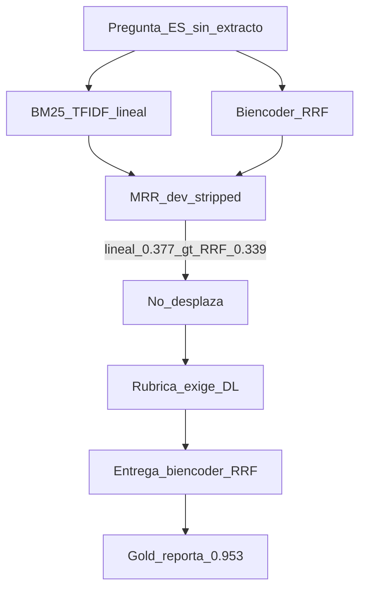

# Modelos clásicos frente al bi-encoder

La pregunta de desarrollo sin identificador pega, entre comillas angulares, un extracto de la descripción en inglés. Esa comparación infla a BM25 y a TF-IDF. Aquí se quita ese extracto y se vuelve a medir. El gold no entra en la elección.

## Hiperparámetros elegidos en desarrollo sin extracto

- BM25: k1=1.5, b=0.9, MRR 0.375.
- TF-IDF de palabras: min_df=1, sublinear_tf=True, n-gramas 1–2, MRR 0.303.
- TF-IDF de caracteres: `char_wb` 3–5, min_df=1, sublinear_tf=True, MRR 0.252.
- Fusión lineal: peso 0.75 sobre BM25 y el resto sobre tfidf_word_df1_sub1, MRR 0.377.

El bi-encoder no se reentrenó. Se cargó `artifacts/fase3/biencoder_best` y se codificó el índice de nuevo, sin escribir en esa carpeta. La fusión RRF usa k=60 y el BM25 publicado (k1=1,5, b=0,75), no el ganador de esta grilla.

## Desarrollo sin identificador

| Sistema | MRR con extracto | MRR sin extracto | R@5 sin extracto |
|---------|-----------------:|-----------------:|-----------------:|
| BM25 k1=1.5 b=0.9 | 0.749 | 0.375 | 0.400 |
| TF-IDF palabras | 0.761 | 0.303 | 0.367 |
| TF-IDF caracteres | 0.695 | 0.252 | 0.267 |
| Fusión lineal w=0.75 | 0.763 | 0.377 | 0.400 |
| MiniLM | 0.654 | 0.144 | 0.167 |
| Multilingüe congelado | 0.557 | 0.070 | 0.067 |
| Bi-encoder 2 épocas | 0.688 | 0.198 | 0.300 |
| RRF publicado | 0.729 | 0.339 | 0.367 |

## Gold, reportado una vez

| Sistema | MRR | R@5 |
|---------|----:|----:|
| BM25 k1=1.5 b=0.9 | 0.398 | 0.500 |
| TF-IDF palabras | 0.906 | 0.938 |
| TF-IDF caracteres | 0.958 | 0.969 |
| Fusión lineal w=0.75 | 0.686 | 0.969 |
| MiniLM | 0.238 | 0.281 |
| Multilingüe congelado | 0.241 | 0.281 |
| Bi-encoder 2 épocas | 0.890 | 0.969 |
| RRF publicado | 0.953 | 1.000 |

## Decisión

La fusión lineal con peso 0,75 supera por 0,038 al RRF (0,377 frente a 0,339) en el desarrollo sin extracto. Ese resultado **no** desplaza al modelo de la entrega.

La rúbrica de Fase III pide un modelo de Deep Learning acorde a los datos y al objetivo (encoder Transformer + red siamesa con pérdida contrastiva; ver M5U4 y M5U5 en `docs/knowledge/base_curso_m4_m5.md`). El ranking que responde es el bi-encoder de dos épocas + RRF. TF-IDF, BM25 y la fusión lineal quedan como baselines del Módulo 4: demuestran que, sin pegar el inglés oficial en la pregunta, el léxico cae y hace falta el embedding multilingüe afinado.

En el gold, que no vota, el RRF queda en 0,953 y la fusión lineal en 0,686. Las preguntas del gold traen el identificador. La pregunta de esta comparación no lo trae y tampoco trae el extracto. Con el extracto pegado, BM25 sube de 0,375 a 0,749 y el bi-encoder de 0,198 a 0,688 (ese 0,688 reproduce el MRR de desarrollo ya publicado).

Figura: `docs/data/figures/fase3_clasicos_vs_dl.png`. El zoo ampliado (LSA, Doc2Vec, DistilUSE) está en [`model_zoo.md`](model_zoo.md).

